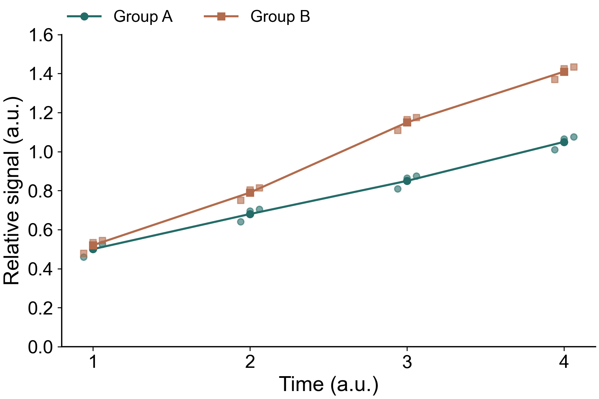

默认风格概括为：**字要清楚，轴要简洁，背景留白，颜色统一，数据优先。** 常规二维图只保留下方X轴和左侧Y轴，去掉上/右边框、装饰背景和默认网格。热图等有实际编码意义的色块保留。

## 常规图直接照这个做

| 部分 | 默认做法 | 需要注意 |
|---|---|---|
| 字体 | 大字、统一字体，轴标题比刻度略大，关键标题适当加粗 | 按最终排版大小检查，不能靠放大整张图预览判断清晰度 |
| 坐标轴 | 下X、左Y；黑色轴线和刻度，去上/右边框 | 保留单位、方向和必要刻度；不为“简洁”删除解释数据所需信息 |
| 背景 | 白色或透明，无灰色panel、无装饰底色 | 透明导出后仍要检查放到白底/幻灯片上是否清楚 |
| 网格 | 常规散点、折线、柱形/箱线等默认关闭 | 只有帮助读值、阈值或特定图形表达时保留有意义的参考线 |
| 配色 | 同一条件跨图固定颜色，少而清楚；必要时加点型/线型区分 | 半透明仅用于减轻点重叠；不把所有元素淡到难以辨认 |
| 图例 | 无边框、无底色，标签简洁；位置留足空间 | 少量曲线也可直接标注；不遮挡数据，字体不突然缩小 |
| 布局 | 绘图区足够大、边距紧凑，标题/标签不裁切 | 独立panel与图例分开交付，拼版时再统一尺寸 |
| 结果表达 | 展示必要的样本点、误差含义、n和统计口径 | 改样式不改数据、模型、阈值、排序或样本集合 |

## 大字应该多大

对约7–8英寸宽的独立图，可从**刻度/图例14–16 pt、轴标题16–18 pt、标题18–20 pt**开始，再按最终尺寸调整。本页模板采用刻度16、轴标题18、标题20、图例14；不是所有图强制固定这些值。

现有论文主题使用过刻度28、轴标题32、标题36等大画布设置。它们适用于对应画布和缩放比例，不能原样套给小panel。缩到稿件栏宽后仍要能读，标题和图例也不必重复占满每张小图。

## 哪些图不硬套XY轴

| 图形 | 保留的必要表达 |
|---|---|
| 热图/相关矩阵 | 色块、色标、样本/组标签与缺失颜色；无背景不等于删除数据色块 |
| Venn/UpSet/网络图 | 按图形语义保留集合、连线和数量，不强加普通XY外框 |
| 分面图 | 组别标题与分区信息保留，避免多余底色与反复图例 |
| 图像/示意图 | 比例尺、方向、必要标注；不凭风格改变图像内容或证据 |

## 合成数据样例

{fig-alt="合成数据的两组散点和趋势线；大字号、仅左/下坐标轴、透明背景、无网格和图例框。" width=85%}

本图为人工合成点和均值线，仅展示风格，不代表实际实验。可下载[透明PNG](../assets/plot-style/clean-xy-example.png)或[可编辑SVG](../assets/plot-style/clean-xy-example.svg)。

## 直接复用主题

**Python / Matplotlib：**下载[clean-xy.mplstyle](../assets/plot-style/clean-xy.mplstyle)，在其所在目录使用：

```python
import matplotlib.pyplot as plt
with plt.style.context("clean-xy.mplstyle"):
    fig, ax = plt.subplots(figsize=(7.2, 4.8), layout="constrained")
    ax.plot(x, y)
    ax.set(xlabel="X / unit", ylabel="Y / unit")
    fig.savefig("panel.svg", transparent=True)
    fig.savefig("panel.png", dpi=600, transparent=True)
```

**R / ggplot2：**下载[theme-clean-xy.R](../assets/plot-style/theme-clean-xy.R)，`source()`后给图加主题：

```r
source("theme-clean-xy.R")
p <- p + theme_experitome()
ggplot2::ggsave("panel.png", p, width = 7.2, height = 4.8,
               units = "in", dpi = 600, bg = "transparent")
```

主题仅改变视觉，不做归一化、补值、统计或图形数据变换。Python样例本轮已执行；R模板按已有ggplot2主题精简，本轮未运行R。实现细节可查[Matplotlib轴线示例](https://matplotlib.org/stable/gallery/spines/spines.html)和[ggplot2主题说明](https://ggplot2.tidyverse.org/reference/theme.html)。

## 导出与检查

默认保留独立panel，PNG用于预览/拼版，SVG/PDF用于矢量编辑或投稿；分辨率和字体嵌入最终按具体期刊要求。逐张检查文字、轴单位、图例、样本点、误差线、色标、裁切与透明效果；只改外观时读取已有数值重画，不重跑模型。

v0.1.0 · 2026-10-19。根据当前确认的视觉约定及论文共享主题整理，不改变原研究脚本或结果。原创说明CC BY 4.0，主题代码MIT。[分析入口](index.qmd) · [本轮维护](../maintenance/entries/2026-10-19-05.qmd)
